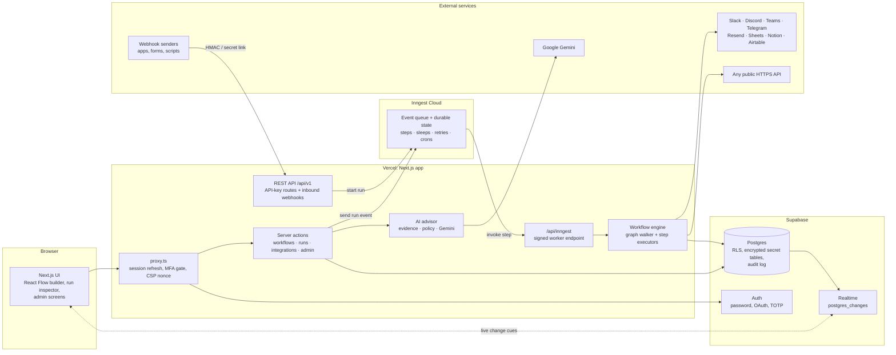
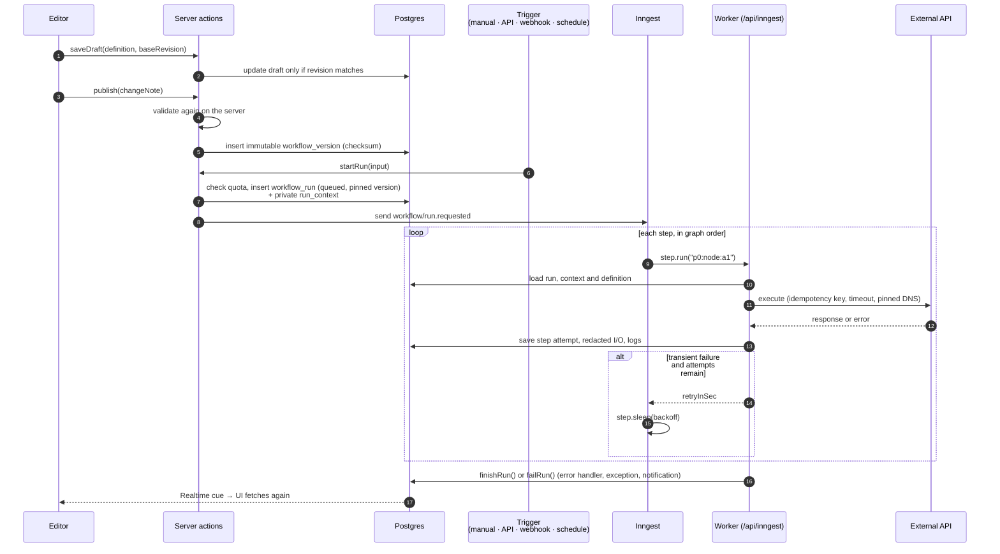
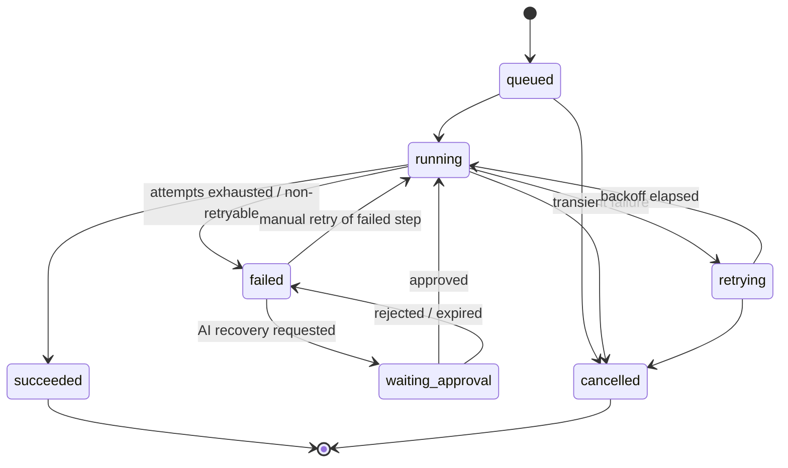
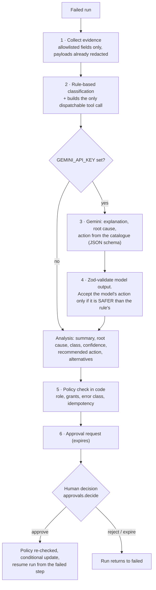
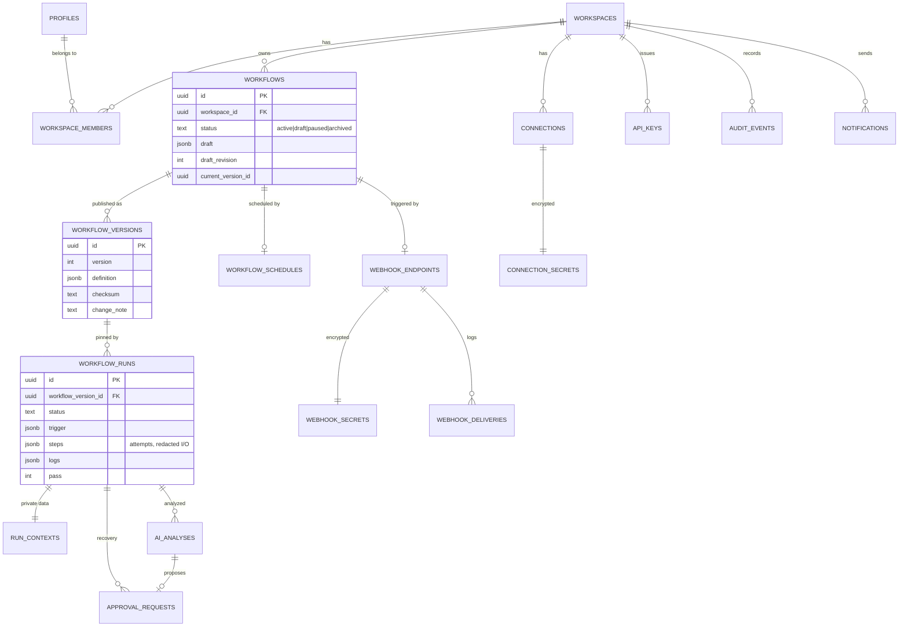
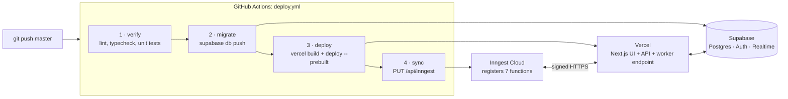

# Brightrail

**Connect your services. Automate your workflows. Control every execution.**

Brightrail is a visual workflow automation platform. You draw multi-step processes on a canvas, connect them to APIs and SaaS tools, and run them on a durable execution engine that survives restarts, retries failures safely and records every step. When a run fails, an AI assistant explains the failure and suggests a fix, and a person approves it before anything happens.

> **Status:** working MVP, live at [brightrail.vercel.app](https://brightrail.vercel.app/). Everything under [Key Features](#5-key-features) is implemented and in the code. Planned work is listed separately in the [Roadmap](#29-roadmap), and current gaps are in [Known Limitations](#28-known-limitations).

---

## Table of Contents

1. [Project Title and Tagline](#brightrail)
2. [Project Overview](#2-project-overview)
3. [Problem Statement](#3-problem-statement)
4. [Project Objectives](#4-project-objectives)
5. [Key Features](#5-key-features)
6. [Product Walkthrough](#6-product-walkthrough)
7. [Technology Stack](#7-technology-stack)
8. [System Architecture](#8-system-architecture)
9. [Workflow Execution Architecture](#9-workflow-execution-architecture)
10. [Visual Workflow Builder](#10-visual-workflow-builder)
11. [Workflow Orchestration and Reliability](#11-workflow-orchestration-and-reliability)
12. [Integration Architecture](#12-integration-architecture)
13. [Credential and Secret Management](#13-credential-and-secret-management)
14. [Multi-Tenancy and Access Control](#14-multi-tenancy-and-access-control)
15. [Workflow Versioning](#15-workflow-versioning)
16. [AI-Assisted Failure Analysis](#16-ai-assisted-failure-analysis)
17. [Database Design and Data Model](#17-database-design-and-data-model)
18. [API Documentation](#18-api-documentation)
19. [Project Structure](#19-project-structure)
20. [Architecture and Design Decisions](#20-architecture-and-design-decisions)
21. [Security Implementation](#21-security-implementation)
22. [Testing Strategy](#22-testing-strategy)
23. [Engineering Challenges and Solutions](#23-engineering-challenges-and-solutions)
24. [Performance and Observability](#24-performance-and-observability)
25. [Getting Started](#25-getting-started)
26. [Environment Variables](#26-environment-variables)
27. [Deployment Architecture](#27-deployment-architecture)
28. [Known Limitations](#28-known-limitations)
29. [Roadmap](#29-roadmap)
30. [Demo and Access Instructions](#30-demo-and-access-instructions)
31. [License and Acknowledgments](#31-license-and-acknowledgments)

---

## 2. Project Overview

Brightrail is in the same category as n8n, Zapier and Make. It is built for small technical teams such as operations engineers, developers and technical founders. These teams need automations they can trust in production, and they want to see what happened when an automation fails.

It handles processes like these:

- **Event-driven notifications:** a form submission or webhook arrives, the payload is checked, and a message goes to Slack, Discord, Microsoft Teams or Telegram.
- **Data sync:** an incoming record is transformed and appended to Google Sheets, or created in Notion or Airtable.
- **Scheduled jobs:** an HTTPS API is called on a cron schedule, the result is checked, and the right team is told.
- **Batch processing:** a list from a payload is processed item by item, with a separate retry for each item.
- **Transactional email:** a welcome or alert email is sent through Resend when an event comes in.

Each workspace is a separate tenant with its own members, roles, credentials, workflows, run history and audit log.

## 3. Problem Statement

Teams that automate business processes run into the same problems again and again:

| Problem | What it looks like in practice |
|---|---|
| **Disconnected applications** | Data lives in Slack, Sheets, Notion, Airtable and internal APIs. Moving it between them means glue scripts that only one person understands. |
| **Repetitive manual tasks** | People copy form submissions into spreadsheets, post status updates by hand and check APIs themselves. |
| **Unreliable integrations** | Third-party APIs time out, rate-limit and fail now and then. A naive retry can send a duplicate email or append a duplicate row. A process restart can lose a half-finished job. |
| **Limited execution visibility** | When an automation fails, there is often no record of which step failed, what input it got or what the provider returned. Deciding whether a retry is safe is guesswork. |
| **Unsafe recovery** | Fixing a failure often means re-running the whole job, which repeats side effects that already succeeded. |

## 4. Project Objectives

1. **Make workflow creation simple.** Workflows are built on a visual canvas, with validation that explains each problem in plain language before anything is published.
2. **Connect backend services safely.** One integration layer covers generic HTTPS calls and first-party connectors, with encrypted credentials and SSRF protection on outbound requests.
3. **Run workflows reliably.** Every step is durable, retries use backoff and idempotency keys, delays are durable timers, and runs survive worker restarts and redeploys.
4. **Show every execution.** Each run records its steps, attempts, redacted inputs and outputs, and structured logs, and screens update live.
5. **Keep people in control of recovery.** AI can explain a failure and recommend an action, but only a person with the right role can approve it, and policy is enforced in code.
6. **Cost nothing to run at small scale.** Everything runs on free tiers: Vercel, Supabase, Inngest, Gemini and Resend.

## 5. Key Features

Everything in this section is **implemented**.

### Visual workflow builder
- A node-based canvas built on React Flow, with a step palette, a configuration panel, undo and redo, and keyboard support.
- **9 step types:** Trigger, HTTP request, Connector action, Condition, For each, Formula, Delay, Transform data and Error handler.
- Validation checks about 35 rules (cycles, unreachable steps, unsafe URLs, missing idempotency, loop bodies that leak out, and more), each tied to a node and field.
- On phones the builder shows an outline view, a bottom-sheet editor and a floating "Add step" button.
- 3 starter templates plus "Start from scratch".

### Multi-step orchestration
- Sequential steps, **conditional branches**, **fan-out** (one output to several steps), **joins** (a step waits for every branch that can still reach it) and **nested For each loops**.
- A **Formula** step with a safe, hand-written expression evaluator (no `eval`).
- **Durable delays** of minutes to days, which use no compute while they wait.
- **Error handlers** with four strategies: open an exception, notify, continue on a fallback path, or fail the run.

### Triggers, API and webhook integrations
- **Triggers:** manual ("Run now"), REST API with an API key, signed inbound webhook, secret-link webhook (for form tools), and schedule (cron, presets or a one-time run, in any IANA time zone).
- **Connectors:** generic HTTPS, Slack, Discord, Microsoft Teams, Telegram, Resend email, Google Sheets, Notion and Airtable.

### Execution monitoring, history and logs
- A run list with filters, and a run inspector that shows each step, every attempt with its idempotency key, error class, and redacted input and output.
- Structured, leveled logs with correlation IDs.
- Live updates over Supabase Realtime, with polling as a fallback.
- Retry a failed step, cancel a run, or re-run it with the same input.
- A dashboard with success rate, failures and recent activity.

### Workflow versioning
- Each publish creates an immutable, checksummed version with a change note. Every run is tied to the exact version it started on.

### Credential management
- Credentials are encrypted with AES-256-GCM in tables that no client can read. The UI shows only a short hint. Credentials can be tested, rotated and revoked.

### AI-assisted failure analysis and recovery
- Google Gemini explains failures from sanitized evidence. A rule-based advisor works when no API key is set.
- Recommendations come from a fixed action catalogue. Retries go through an **approval queue** with expiry, and are dispatched only after an authorized person approves.

### Workspace administration
- Five roles (Owner, Admin, Editor, Operator, Viewer) with configurable grants, invitations, suspension and ownership transfer.
- API keys with scopes and expiry, an append-only audit log, Free and Team usage quotas, retention settings and account deletion.
- Sign-in with email and password, Google or GitHub, with optional TOTP two-factor authentication.
- In-app and email notifications for failed runs and approval requests.

## 6. Product Walkthrough

| Screen | What it shows |
|---|---|
| **Dashboard** | Run volume, success rate, open exceptions, pending approvals, recent failures, and a "Getting started" checklist for new workspaces. |
| **Workflow editor** | The canvas with trigger, condition, loop and connector steps. Branch handles (`true`/`false`, `each`/`next`, `on error`) show how data moves through the workflow. |
| **Node configuration** | The side panel for an HTTP step: method, URL with `{{field}}` templates, headers, JSON body, timeout, retry attempts and the idempotency-key toggle. Validation errors appear next to the field they belong to. |
| **Execution history** | Every run with its status, trigger source, version, duration and start time, filterable by workflow, status and date. |
| **Run inspector and logs** | The timeline for one run: each step's attempts, backoff waits, error codes and classes, redacted input and output, and the structured log stream. Updates live while the run is in progress. |
| **AI analysis and approvals** | The assistant's explanation, likely root cause, classification, confidence and recommended action, next to the approval card where an Operator or Admin approves or rejects with a reason. |

**Live demo:** [brightrail.vercel.app](https://brightrail.vercel.app/) (see [Demo and Access Instructions](#30-demo-and-access-instructions)).

## 7. Technology Stack

| Layer | Technologies |
|---|---|
| **Frontend** | Next.js 16 (App Router), React 19, TypeScript 5 (strict), Tailwind CSS 4, Radix UI primitives with in-repo shadcn-style components, React Flow (`@xyflow/react`) for the canvas, TanStack Query, Zustand, Sonner, Lucide icons, Geist font |
| **Backend** | Next.js server actions and route handlers on Node.js, Zod for validation, `server-only` boundaries |
| **Database** | Supabase Postgres with row-level security, SQL migrations, and Postgres functions for atomic counters and retention |
| **Workflow orchestration** | Inngest: durable steps, sleeps, cron functions, cancellation and concurrency keys. `cron-parser` for schedules |
| **Integrations** | Native `node:https` with DNS pinning; Slack, Discord, Microsoft Teams, Telegram, Resend, Google Sheets (service-account JWT signed in-process), Notion and Airtable |
| **Authentication** | Supabase Auth (email and password, Google and GitHub OAuth, TOTP MFA) through `@supabase/ssr` cookie sessions |
| **AI** | Google Gemini (`gemini-2.5-flash` by default) with JSON-schema output, plus a deterministic rule-based fallback |
| **Infrastructure** | Vercel (hosting), Inngest Cloud (workers), Supabase (database, auth, Realtime), Resend (email), GitHub Actions (CI/CD) |
| **Testing** | Vitest, Testing Library and jsdom (unit), Playwright (end-to-end), `@axe-core/playwright` (accessibility), a custom WCAG contrast checker |

## 8. System Architecture



**Monitoring.** Run state, step attempts, structured logs, webhook delivery records and audit events all live in Postgres and appear in the app. Inngest's dashboard shows function-level traces (every step, sleep and retry). Server errors are logged with a `[brightrail]` prefix to Vercel's runtime logs.

## 9. Workflow Execution Architecture

A workflow goes through five stages: **create → validate → publish → trigger → execute and monitor**.



**Execution flow:**

1. **Creation.** Editors change a draft (`workflows.draft`, JSONB). Saves use optimistic concurrency (`draft_revision`), so two people editing the same workflow can't overwrite each other without noticing.
2. **Validation.** `lib/domain/validation.ts` is shared by the browser and the server. The editor shows problems as you type, and `publish()` runs the validation again on the server, because results from the client aren't trusted.
3. **Triggering.** Every trigger path calls `startRun()`. It checks that the workflow is active, enforces the monthly execution quota, pins the run to the current published version, creates the `workflow_runs` row and a private `run_contexts` row, and sends an Inngest event. If the event can't be sent, the run is marked failed with a clear message instead of staying queued forever.
4. **Execution.** One Inngest function (`run-workflow`) runs each workflow. The order of execution comes from a pure graph walker (`lib/engine/walk.ts`). Each node attempt is a memoized `step.run`, and each backoff or delay is a `step.sleep`, so a redeploy in the middle of a run resumes where it left off without repeating finished steps.
5. **Monitoring.** Every attempt writes its status, timing, redacted input and output, and log lines to the run row. Supabase Realtime tells open screens that something changed, and they fetch fresh data through server actions.

**How nodes and steps interact.** Nodes share a single **run context**: the trigger payload, plus `steps.<id>` outputs, plus loop variables (`item`, `index`, `loop`). Steps read values with `{{path}}` templates and field paths, and write results back to the context. The context is stored server-side in `run_contexts`, which has no client access, while only **redacted** copies are stored on the run for display. Each executor returns a small, serializable result (`ok`, `branch`, `retryInSec`) to Inngest, so secrets and large payloads never end up in Inngest's step history.

**Run lifecycle:**



## 10. Visual Workflow Builder

The builder (`src/features/builder/`) is a React Flow canvas backed by a reducer-based editor store (`state.ts`).

- **Building.** Steps are added from a palette, placed on the canvas and connected by dragging between handles. Each node type has its own output handles: `default`, `true`/`false` on conditions, `each`/`next` on loops, and `error` for routing failures to an error handler.
- **Connection rules.** `canConnect()` rejects invalid edges as you draw them: edges into the trigger, self-loops, duplicate edges, an error output that doesn't point to an error handler, and anything that would create a cycle.
- **Inputs and outputs.** Steps read data through `{{field}}` templates (URLs, headers, message text), JSON body templates, field mappings (Transform, Sheets, Notion, Airtable) and formula expressions. A trigger can list **required fields**, and a run fails validation right away if one is missing.
- **Editing.** Undo and redo, with consecutive keystrokes in one field merged into a single history entry. A drag commits one entry when you drop. Unsaved-changes guard, explicit save, and conflict detection on save.
- **Validation.** About 35 rules, each with a code, severity, node and field (for example `CYCLE`, `UNREACHABLE`, `UNSAFE_URL`, `SECRET_IN_HEADER`, `LOOP_LEAK`, `NO_IDEMPOTENCY`, `CONNECTION_TYPE`, `SCHEDULE`). Errors block publishing. Warnings such as a non-idempotent retry don't.
- **Accessibility.** Steps can be added and configured from the keyboard (covered by an end-to-end test). On small screens the builder defaults to an outline view, and configuration opens in a bottom sheet.

## 11. Workflow Orchestration and Reliability

| Concern | How Brightrail handles it |
|---|---|
| **Durable state** | Every attempt, backoff and delay is a memoized Inngest step. If the worker restarts, Inngest replays the function and skips finished steps. |
| **Retries** | HTTP and connector steps have `maxAttempts` (1–10). Backoff is exponential, `initial × coefficient^(attempt−1)`, capped at a maximum (defaults 2 s × 2, capped at 60 s), and each workspace can change it. Only errors classified as **transient** (timeouts, 5xx, 429, network) are retried. |
| **Error classification** | Every failure is classed as `transient`, `configuration`, `validation`, `permission` or `unknown`. Manual and AI-approved retries are blocked for `permission` and `validation`, because the same credential or input would fail again. |
| **Idempotency** | Each step gets a deterministic idempotency key derived from the run and node, and from the iteration inside loops. It is sent as `Idempotency-Key` to Resend and to HTTP steps that enable it, and stays the same across retries. |
| **Timeouts** | Per-step timeout of 1–120 s. Outbound response bodies are capped at 64 KB. The worker endpoint's `maxDuration` is 60 s. |
| **Long-running workflows** | Delays use `step.sleep`, which uses no compute while waiting, so a workflow can wait days. Schedules use `step.sleepUntil` on a single pending tick for each workflow. |
| **Failure handling** | A terminal failure follows the step's `error` edge to an Error handler (`create_exception`, `notify`, `fallback_path` or `fail_run`). Otherwise the run fails and an **exception** is opened for review, a notification is sent and an audit event is written. |
| **Resuming from failure** | A retry sends a new pass (`pass + 1`) with `resumeFromNodeId`. The workflow continues **from the failed step** with one more attempt, without repeating earlier steps. A failure inside a loop restarts the outermost loop around it, and per-item idempotency keys stop duplicate side effects. |
| **Cancellation** | `cancelOn` matches the `workflow/run.cancelled` event. In-flight work stops at the next step boundary, and pending approvals are expired. |
| **Concurrency** | Each run is limited to one executing instance (`concurrency: { key: runId, limit: 1 }`). Retries claim the run with a conditional update and use deterministic event IDs, so two people clicking "Retry" at once start only one pass. |
| **Background jobs** | Seven Inngest functions: workflow runner, schedule tick, hourly schedule re-arm, approval expiry timer, hourly approval sweep, nightly retention purge and notification emails. |

## 12. Integration Architecture

Integrations are defined in a catalogue (`lib/integrations/catalog.ts`). Each action is carried out by a handler registered in `server/infrastructure/executors/action-handlers.ts` (the generic HTTP step has its own strategy in `node-executors.ts`), which calls the vendor code in `server/infrastructure/connectors/`. Connection tests are registered the same way in `connection-testers.ts`, so adding a connector means adding entries, not editing a `switch`.

```mermaid
flowchart LR
  Node["HTTP / Connector step"] --> Load["loadConnection()<br/>same workspace + same integration"]
  Load --> Decrypt["Decrypt secret in memory<br/>(AES-256-GCM, record-bound AAD)"]
  Decrypt --> Build["Fill templates<br/>(URL-encoded / JSON-escaped)"]
  Build --> Guard["assertPublicHost()<br/>HTTPS only, DNS lookup, reject private IPs"]
  Guard --> Send["pinnedRequest()<br/>connect to the checked IP, no redirects,<br/>timeout, 64 KB body cap"]
  Send --> Classify["classifyHttpStatus()<br/>transient / permission / validation / configuration"]
  Classify --> Result["Redacted result → run record"]
```



| Integration | Authentication | Notes |
|---|---|---|
| **HTTPS request** | Optional bearer token, API-key header or basic auth from a connection | GET/POST/PUT/PATCH/DELETE, templated URL, headers and body, optional idempotency key |
| **Inbound webhooks** | HMAC-SHA256 signature + timestamp, or a secret-link key | Replay window, per-endpoint body limit and rate limit, event-ID and signature deduplication, JSON or form bodies |
| **Schedule** | — | Cron or presets, IANA time zone, one-time runs, at least 5 minutes between runs |
| **Slack / Discord** | Incoming webhook URL (stored encrypted) | Templated messages |
| **Microsoft Teams** | Workflows webhook URL | Adaptive Card; retired Office 365 connector URLs are rejected |
| **Telegram** | Bot token | Send message to a chat |
| **Resend** | API key | Transactional email, sent with an idempotency key |
| **Google Sheets** | Service account (RS256 JWT signed in-process) | Append a row by header name or column letter; values are written `RAW`, so formulas in incoming data never run |
| **Notion** | Integration token | Create a page in a data source (API `2025-09-03`) |
| **Airtable** | Personal access token | Create a record (with typecast) |

Every vendor connector uses **fixed vendor hosts**, so user data can't redirect a request somewhere else. A connection is only loaded if it belongs to the run's workspace **and** matches the integration the step expects, so an HTTP step can't borrow and leak a Slack or Notion credential. Connections can be tested before saving, and each one tracks its status, last test time and last error.

## 13. Credential and Secret Management

- **Encryption at rest.** Connector credentials and webhook signing secrets are encrypted with **AES-256-GCM** using `BRIGHTRAIL_ENCRYPTION_KEY` (32 bytes). The format is `v2.<iv>.<tag>.<ciphertext>`, and the record ID (`connection:<id>`, `webhook:<id>`) is bound as **additional authenticated data**, so a ciphertext copied onto another row won't decrypt.
- **Storage separation.** Ciphertexts live in `connection_secrets` and `webhook_secrets`. These tables have **RLS enabled, no policies and no grants** for the `authenticated` or `anon` roles, so only the server's service role can read them. Metadata (name, status, a 4-character hint) is kept in separate tables that members can read.
- **Use during a run.** A secret is decrypted inside the executor call, used for one request and discarded. It is never returned from the executor, so it never reaches Inngest's step history, run records or logs.
- **Shown once.** New webhook signing secrets and API keys are shown a single time. **API keys** (`br_live_…`) are stored only as SHA-256 hashes.
- **Lifecycle.** Credentials can be rotated (the rotation time is recorded) and revoked. Every create, rotate and revoke action is audited. Only roles with `connections.manage` can do this.
- **Redaction.** Payloads are redacted before they are stored on a run. Values under secret-looking keys become `[REDACTED]`, and emails and phone numbers are masked. Workspaces can also choose "minimal metadata", which stores no step input or output bodies at all.
- **Validation.** The builder blocks secrets typed directly into HTTP headers (`SECRET_IN_HEADER`). Credentials have to come from a connection.

## 14. Multi-Tenancy and Access Control

**Workspace isolation.** Every tenant-owned table has a `workspace_id`. The server works out the caller's workspace from an **active membership** (`SessionResolver.context()`, called by every action through `inWorkspace`). The workspace cookie is only a preference, and it is ignored if the user isn't an active member of that workspace. Every query then filters by `workspace_id` explicitly. As a second layer of defence, Postgres **row-level security** lets members *read* only their own workspace's rows, which is also what limits Realtime events. **No client can write to the database directly.** All writes go through server code after a permission check.

**Roles and permissions** (`lib/domain/permissions.ts`):

| Permission | Owner | Admin | Editor | Operator | Viewer |
|---|:-:|:-:|:-:|:-:|:-:|
| View workflows, runs, connections, members | ✓ | ✓ | ✓ | ✓ | ✓ |
| Create and edit drafts | ✓ | ✓ | ✓ | | |
| Publish versions | ✓ | ✓ | grant (on) | | |
| Trigger runs | ✓ | ✓ | ✓ | ✓ | |
| Retry failed steps | ✓ | ✓ | grant (off) | ✓ | |
| Cancel runs | ✓ | ✓ | | ✓ | |
| Approve AI recovery actions | ✓ | ✓ | | grant (on) | |
| Manage connections | ✓ | ✓ | | | |
| Manage members, settings, API keys | ✓ | ✓ | | | |
| View audit log | ✓ | ✓ | | | grant (off) |
| Delete workspace | ✓ | | | | |

"grant" marks one of four permissions each workspace can switch on or off (the default is in brackets). Grants outside this allowlist are ignored even if they are stored in the database. Admins can't change other Admins. Only the Owner can transfer ownership. API keys stop working as soon as the member who created them is removed or suspended.

**Quotas.** Monthly executions, members and active connections are enforced on the server for each workspace (Free: 1,000 runs, 5 members, 10 connections; Team: 25,000, 50 and 100).

## 15. Workflow Versioning

- **Draft and published versions are separate.** Editors always work on a mutable draft. Publishing **freezes** the draft into a `workflow_versions` row with an incrementing `version`, the full `definition`, a content **checksum**, the publisher and a change note.
- **Immutable history.** Published versions are never edited. Publishing a draft that matches the current version (same checksum) is refused, and the UI flags "unpublished changes" by comparing checksums.
- **Runs are pinned.** Every run stores `workflow_version_id` and `version`, and the worker always loads that exact definition. Editing or republishing never changes a run that is already in progress, and the run inspector shows which version produced it.
- **Inspection.** The workflow page's **Versions** tab lists every version with its number, checksum, publisher, date and change note. The **Overview** tab shows the steps in the published version.
- **Not yet implemented:** one-click **restore** of an old version into the draft, and a visual **diff** between versions (see [Roadmap](#29-roadmap)).

## 16. AI-Assisted Failure Analysis

When a run fails, an Operator or Admin can ask the AI exception assistant to analyze it. **The model can explain and recommend. It cannot execute anything.**



**Safeguards:**

- **Fixed action catalogue.** `retry_failed_step`, `reconnect_credential`, `correct_field` and `no_action`. The model chooses from this list but never chooses arguments, URLs or tenants. The tool call is always built by deterministic code.
- **Prompt-injection defence.** The system prompt treats all evidence strictly as data. The model only sees sanitized, allowlisted fields, and its JSON output is validated with Zod (length limits and enums). A response that doesn't fit is thrown away, and the rule-based result is used instead.
- **The model can only lower risk.** If Gemini suggests a riskier action than the rule-based advisor did, the safer action is kept.
- **Human approval required.** Retries change things outside Brightrail, so they always go through an approval request. The decision needs `approvals.decide`. Policy, step state and workflow status are **checked again at decision time**, and conditional updates (`status = pending AND expires_at > now`) make sure only one decision or expiry wins.
- **Expiry.** Each request has its own Inngest timer, with an hourly sweep as a backup. An expired request returns the run to Failed.
- **Budget and audit.** At most 60 analyses per workspace per hour, counted atomically in Postgres. Each analysis records the model and prompt version and writes an audit event.
- **Works without AI.** With no `GEMINI_API_KEY`, the rule-based advisor still classifies failures and recommends actions.

## 17. Database Design and Data Model

The schema is in `supabase/migrations/0001–0008`. The main entities:



| Entity | Purpose |
|---|---|
| `profiles` | One per Supabase auth user: name, title, notification preferences, onboarding state. |
| `workspaces` | Tenant: plan, settings (time zone, retention, retry policy, AI toggle, payload storage), permission grants, quotas. |
| `workspace_members` | User ↔ workspace with role and status (`active`, `invited`, `suspended`). |
| `workflows` | Metadata plus the mutable **draft** definition (nodes and edges as JSONB) with a revision counter. |
| `workflow_versions` | Immutable published definitions with a checksum. |
| `workflow_runs` | One row per execution: status, trigger, pinned version, step summaries with every attempt, logs, exception state, `pass`. |
| `run_contexts` | Unredacted working data for the worker. **Server-only.** |
| `workflow_schedules` | Cron, time zone, next and last run, `version` (makes old ticks stale), run-once flag. |
| `connections` / `connection_secrets` | Credential metadata, and encrypted credential material (server-only). |
| `webhook_endpoints` / `webhook_secrets` / `webhook_deliveries` | Endpoint settings, encrypted signing secrets, and a delivery log that also serves as the idempotency record. |
| `ai_analyses` / `approval_requests` | AI output, and human-approved recovery actions (with a unique index allowing only one pending request per run). |
| `api_keys` | SHA-256-hashed keys with scopes, expiry and status. |
| `audit_events` | Append-only (a trigger blocks updates and deletes). |
| `notifications` / `notification_reads` | Workspace notifications, with read state for each person. |
| `rate_windows`, `webhook_rate_windows`, `auth_email_windows` | Atomic fixed-window counters for rate limiting. |

**Design notes.** Step results are stored as JSONB on the run instead of in a separate `step_runs` table, so the run inspector loads a run in one query. Unredacted data is split into `run_contexts` so it can be locked down separately. Nightly retention (`purge_expired_runs()`) deletes finished runs older than each workspace's setting (7, 14, 30 or 90 days), with their cascaded analyses and approvals. Running runs and the audit log are never purged.

## 18. API Documentation

Brightrail has two API surfaces:

1. **Public REST API** (`/api/v1`) for external systems, authenticated with API keys or webhook signatures.
2. **Server actions** (`src/server/actions/*`) for the web app, authenticated with the Supabase session cookie. They aren't a public API.

### REST endpoints

| Method | Path | Auth | Purpose |
|---|---|---|---|
| `POST` | `/api/v1/workflows/{id}/runs` | `Bearer br_live_…` with scope `runs:trigger` | Start a run of the published version with a JSON body as input |
| `GET` | `/api/v1/runs/{id}` | `Bearer br_live_…` with scope `runs:read` | Run status and step summaries |
| `POST` | `/api/v1/webhooks/{endpointId}` | HMAC signature, or secret-link key | Inbound webhook trigger |
| `GET`/`POST`/`PUT` | `/api/inngest` | Inngest request signature | Worker endpoint, called by Inngest only |

**Trigger a run**

```bash
curl -X POST https://<your-app>/api/v1/workflows/<workflow-id>/runs \
  -H "Authorization: Bearer br_live_xxxxxxxx" \
  -H "Content-Type: application/json" \
  -d '{"email": "ada@example.com", "plan": "team"}'
```

```json
// 202 Accepted
{ "runId": "4f6c…", "status": "queued" }
```

**Read a run**

```json
// GET /api/v1/runs/{id} → 200
{
  "id": "4f6c…", "workflow_id": "9a1e…", "workflow_name": "Welcome email",
  "version": 3, "status": "succeeded",
  "started_at": "2026-11-08T10:00:00Z", "ended_at": "2026-11-08T10:00:02Z",
  "steps": [{ "nodeLabel": "Send email", "status": "succeeded", "attempt": 1, "attempts": [/* … */] }]
}
```

**Send a signed webhook**

```bash
TS=$(date +%s)
BODY='{"name":"Ada","email":"ada@example.com"}'
SIG="sha256=$(printf '%s.%s' "$TS" "$BODY" | openssl dgst -sha256 -hmac "$SIGNING_SECRET" -hex | sed 's/^.* //')"

curl -X POST https://<your-app>/api/v1/webhooks/<endpoint-id> \
  -H "Content-Type: application/json" \
  -H "X-Brightrail-Timestamp: $TS" \
  -H "X-Brightrail-Signature: $SIG" \
  -H "X-Brightrail-Event-Id: evt_123" \
  -d "$BODY"
```

| Response | Meaning |
|---|---|
| `202 {"accepted": true, "runId": "…"}` | Verified and a run started |
| `200 {"duplicate": true, "runId": "…"}` | Same event ID or same signed body already accepted. The same response comes back every time |
| `401 BAD_SIGNATURE` / `REPLAY_WINDOW` / `BAD_KEY` | Verification failed |
| `410 GONE` | Endpoint disabled |
| `413 PAYLOAD_TOO_LARGE` | Over the endpoint's limit (hard cap 1 MB) |
| `429 RATE_LIMITED` / `QUOTA_EXCEEDED` | Over the per-minute limit (with a `Retry-After` header) or the monthly quota |
| `409 NOT_ACCEPTING` | Workflow paused or never published (no run is started, and the sender can retry later) |

**Errors** all use the same shape: `{ "code": "VALIDATION" | "UNAUTHENTICATED" | "FORBIDDEN" | "NOT_FOUND" | "CONFLICT" | "RATE_LIMITED" | "INTERNAL", "message": "…" }`.

> API-key scopes `workflows:read`, `workflows:write`, `webhooks:manage` and `audit:read` can already be issued, but no REST endpoints use them yet (see [Roadmap](#29-roadmap)). Pre-rename `ff_live_…` keys and `X-FlowForge-*` headers are still accepted.

## 19. Project Structure

Brightrail is a **single Next.js application**, not a monorepo. The UI, the server API, the workflow engine and the worker endpoint are deployed together, and server-only modules are kept apart with `import "server-only"`. The engine's pure logic lives in `src/lib/engine`, so it can be tested without any services and moved into a separate worker package later.

```
.
├── .github/workflows/deploy.yml   CI/CD: verify → migrate → deploy → sync Inngest
├── supabase/
│   ├── config.toml
│   └── migrations/                0001–0008: schema, RLS, grants, schedules, quotas, security fixes
├── e2e/                           Playwright specs (accessibility + live end-to-end flow)
├── scripts/                       install check, WCAG contrast check
└── src/
    ├── app/                       Next.js routes
    │   ├── (app)/                 dashboard, workflows, executions, approvals, integrations, settings
    │   ├── (builder)/             full-screen workflow editor
    │   ├── (auth)/                sign-in, sign-up, MFA, password reset
    │   ├── api/v1/                public REST API + inbound webhooks
    │   ├── api/inngest/           durable worker endpoint
    │   └── onboarding/, setup/    first-run guide, missing-configuration page
    ├── proxy.ts                   session refresh, MFA (AAL2) gate, per-request CSP nonce
    ├── server/                    server-only code, in clean-architecture layers
    │   ├── actions/               presentation: thin server actions = the app's internal API
    │   ├── presentation/          action wrapper (auth + permission + Result envelope), public-API helpers
    │   ├── application/           use cases as services; depend only on ports/
    │   │   ├── ports/             repository and gateway interfaces (EventBus, SecretStore, NodeExecutor, …)
    │   │   ├── workflows/, runs/, engine/, integrations/, admin/, account/, notifications/
    │   │   └── shared/            RequestContext, AuditLog, errors, paging, throttles
    │   ├── infrastructure/        adapters that implement the ports
    │   │   ├── supabase/          clients, row mappers, repositories, error translation
    │   │   ├── inngest/           client, event bus, durable functions
    │   │   ├── executors/         node strategies, action-handler and connection-tester registries, SSRF-safe outbound HTTP
    │   │   ├── security/          AES-256-GCM, HMAC, hashing, encrypted secret store
    │   │   ├── auth/, email/, ai/, connectors/, http/, config/
    │   └── container.ts           composition root: wires adapters into services
    ├── lib/                       shared, framework-free logic
    │   ├── engine/                graph walker, formula evaluator, templating, backoff, schedules
    │   ├── domain/                types, validation rules, permissions, redaction, SSRF checks, plans
    │   ├── ai/advisor.ts          evidence collection, classification, action catalogue, policy
    │   └── integrations/          integration catalogue
    ├── features/                  screen-level UI: builder, executions, workflows, ai, integrations, admin, auth
    └── components/                design system (ui/), layout, shared widgets
```

## 20. Architecture and Design Decisions

| Decision | Why |
|---|---|
| **TypeScript end to end, strict mode** | One set of types (`lib/domain/types.ts`) describes workflow definitions, runs and permissions for the builder, the server and the worker, so a node config change shows up as a compile error everywhere it's used. |
| **Execution logic separate from the visual editor** | The editor only produces a JSON `WorkflowDefinition`. Running it is handled by `lib/engine/walk.ts` (order) and `server/infrastructure/executors/` (side effects). The walker takes its operations as parameters (`WalkOps`): Inngest steps in production, plain functions in tests. |
| **Inngest instead of a hand-rolled queue** | Durable steps, sleeps, retries, crons, cancellation and concurrency keys out of the box, serverless-friendly (it calls the app over HTTP), and a free tier. The spec's Temporal design maps closely onto it, and the step boundaries are kept so Temporal could replace it later. |
| **Postgres (Supabase) as the system of record** | Relational integrity for tenants, roles and versions, JSONB for flexible definitions and step data, RLS for defence in depth, Realtime for live screens, and Postgres functions for **atomic counters and claims** without Redis. Auth is included. |
| **Server actions as the internal API** | Each action is one line: `inWorkspace(permission, (app, ctx) => app.<service>.<useCase>(ctx, …))`. Authentication, tenant resolution and the permission check happen once in `inWorkspace`; `act()` wraps results so typed errors reach the client intact (Next.js hides thrown messages in production). |
| **Clean architecture on the server** | Dependencies point inward: `actions` → `application` services → `ports` interfaces ← `infrastructure` adapters. Use cases never import Supabase, Inngest or `fetch`; repositories take the workspace id on every tenant-scoped call. `container.ts` is the single place that wires concrete classes, so services are unit-tested with in-memory fakes. |
| **Design patterns where they remove branching** | Repository (one per aggregate), Strategy (one executor per node kind, one handler per action key, one probe per connector), Adapter (Inngest, Resend, Supabase Auth behind ports), Factory (first workflow draft), Composition Root / Singleton (the container). |
| **Modular feature layout** | `features/*` (UI), `server/actions/*` (API) and `server/application/*` (use cases) line up with each other, so each area of the product can be found in three predictable places. |
| **Pure, I/O-free core** | Validation, permissions, redaction, SSRF checks, formulas, templating, backoff and schedule maths have no I/O and are unit-tested on their own. |
| **Deterministic policy around AI** | Model output is treated as untrusted. Code builds tool calls and enforces policy, and a person approves. |
| **Free-tier first** | Vercel, Supabase, Inngest, Gemini and Resend all have free tiers, so the whole platform can run at no cost. |
## 21. Security Implementation

| Area | Implementation |
|---|---|
| **Authentication** | Supabase Auth with HttpOnly cookie sessions refreshed in `proxy.ts`. Email and password (≥10 characters with a letter and a number), Google and GitHub OAuth, email confirmation, password recovery. **TOTP two-factor**, enforced at AAL2 in the proxy *and* in every server action. Sign-up and reset never reveal whether an account exists. Auth emails are limited to 3 per address and 20 per IP per hour. |
| **Authorization** | Role-permission matrix with an allowlist of grants, checked on the server for every action. The UI only reflects it. |
| **Workspace isolation** | Workspace resolved from active membership, explicit `workspace_id` filters, read-only RLS as a second layer, explicit table grants (none for `anon`, none on secret tables). |
| **Encrypted credentials** | AES-256-GCM with record-bound AAD, server-only tables, secrets that never leave the executor, SHA-256-hashed API keys. |
| **API security** | Scoped and expiring API keys, revoked automatically when their creator leaves. Webhooks use HMAC-SHA256 with a timestamp **replay window**, **constant-time** comparison, deduplication by event ID and signature, per-endpoint rate limits (counted only after authentication), a flood guard and body limits. |
| **Worker endpoint** | `/api/inngest` refuses to serve in production if signing isn't configured, and rejects unsigned or oversized requests before the SDK parses them. |
| **SSRF protection** | Public HTTPS only. Private, loopback, link-local and metadata addresses, and URLs with inline credentials, are rejected. The DNS result is checked and the connection is **pinned to the checked IP** (defeats DNS rebinding). Redirects are never followed. |
| **Injection resistance** | URL templates are URL-encoded, JSON body templates are escaped by context, and formulas use a hand-written parser (no `eval`/`Function`, `__proto__`/`constructor`/`prototype` blocked, depth and size limits). Sheets values are written `RAW`. Form keys like `__proto__` are dropped. |
| **Protection against unauthorized execution** | Only **active, published** workflows run. Runs need `runs.trigger` (session) or `runs:trigger` (API key) or a verified webhook. Paused workflows refuse runs. Retries of permission or validation failures are blocked. AI actions need human approval. |
| **Input validation** | Zod schemas on server inputs, about 35 workflow validation rules checked again on the server at publish, body-size limits on every public endpoint. |
| **Browser hardening** | Per-request nonce-based **Content-Security-Policy** with `strict-dynamic`, HSTS (2 years), `X-Frame-Options: DENY`, `nosniff`, a strict referrer policy and a locked-down Permissions-Policy. |
| **Data minimization and audit** | Payload redaction, an optional "minimal metadata" mode, retention purge, and an append-only audit log enforced by a database trigger. |

The security fixes from an internal audit are covered by dedicated `*.security.test.ts` suites and migration `0008_security_fixes.sql`.

## 22. Testing Strategy

| Level | Tooling | What's covered |
|---|---|---|
| **Unit (pure logic)** | Vitest | **Graph walker:** fan-out and joins, condition branches, loops (nested and empty), failure with error-handler continuation. **Formula engine:** operators, functions, sandbox-escape attempts. **Engine logic:** templating and JSON escaping, backoff, HTTP status classification, idempotency keys, conditions. **Schedules:** cron presets, time zones, **DST transitions**, minimum interval. **Domain:** validation rules, permissions, redaction. |
| **Unit (server, mocked I/O)** | Vitest (`node` environment) | **Executors:** SSRF blocking (private IPs, rebinding, redirects), connection-type isolation. **Connectors:** Telegram, Teams, Notion, Airtable request shapes and error classes. **Google Sheets:** JWT signing, header mapping, fixed hosts. **Crypto:** AAD binding, tamper detection. **Webhooks:** form parsing and prototype-pollution guard. **Auth emails:** idempotency, HTML escaping, throttling. |
| **Component** | Vitest + Testing Library + jsdom | Builder editor reducer: undo and redo merging, connection rules, cycle prevention. |
| **End-to-end** | Playwright | Sign-in validation; **create a workflow → add a step with the keyboard → save → publish → run** against a live Supabase and Inngest setup (needs `E2E_EMAIL`/`E2E_PASSWORD`). |
| **Accessibility** | `@axe-core/playwright`, `npm run check:contrast` | No axe violations on public and app screens, no horizontal overflow on small screens, WCAG contrast of design tokens. |
| **Static** | `tsc --noEmit`, ESLint | Strict types, lint with zero warnings. |

```bash
npm test               # 16 Vitest files, no external services needed
npm run test:e2e       # Playwright + axe
npm run typecheck && npm run lint
```

CI runs lint, typecheck and unit tests on every push to `master`, and nothing deploys if they fail.

**Gaps (honest view):** there are no automated integration tests against a real Postgres database or a running Inngest dev server. Retries, timers and resume logic are tested through the walker with mocked operations and checked by hand against Inngest. Coverage is not measured yet. Real vendor APIs are mocked in tests.

## 23. Engineering Challenges and Solutions

### 1. Keeping execution state consistent across restarts and replays
**Problem.** Inngest replays a function from the start after each step, and a deploy can happen in the middle of a run. The engine needed one source of truth for run state that replays can't corrupt.
**Solution.** Each piece of work (one node attempt, one backoff, one delay, one loop iteration setup) is its own memoized `step.run` or `step.sleep` with a **stable, unique step ID** built from the pass, node and loop iteration (`p1:n_http:i3:a2`). Postgres holds the durable run record. Inngest holds only small serializable results. The walker's order is deterministic, so a replay takes exactly the same path.

### 2. Handling failed nodes without repeating successful side effects
**Problem.** "Retry the run" would send a second email or append a second row for steps that already succeeded.
**Solution.** Retries **resume from the failed node** as a new pass (`pass + 1`, `resumeFromNodeId`), with exactly one more attempt. Inside loops, the outermost enclosing loop restarts, and **per-item idempotency keys** (`node@loop:index`) let providers drop duplicates. Failures are classified, so retries of permission or validation errors (which can't succeed) are blocked.

### 3. Preventing duplicate executions
**Problem.** Duplicates come from several directions: webhook senders retrying, signed requests replayed with a new event-ID header, two people clicking "Retry" at once, overlapping schedule ticks, approval decisions racing their expiry.
**Solution.** Several layers. An **idempotency record is written before the run starts** (and removed if the run can't start, so the sender's retry still works). Deduplication on the **signed body hash** as well as the event ID. **Conditional updates** for claims (`UPDATE … WHERE status = 'failed'`, `WHERE next_run_at = <slot> AND version = <v>`). **Deterministic Inngest event IDs** so a duplicate send does nothing. A **unique partial index** allowing one pending approval per run. `concurrency: { key: runId, limit: 1 }`.

### 4. Long-running and scheduled workflows on serverless
**Problem.** Vercel functions time out after seconds, but workflows can wait for days, and cron schedules have to fire exactly once without a poller running every minute.
**Solution.** Delays are `step.sleep`, so nothing runs while a workflow waits. Each schedule keeps **one pending tick** that `sleepUntil`s its slot, claims it atomically in Postgres, starts the run and arms the next tick. A `version` counter makes old ticks stale after any edit, pause or archive. An **hourly reconcile** job re-arms lost timers and **skips missed slots** instead of firing a burst of catch-up runs. One-time schedules switch themselves off.

### 5. Branches, joins and loops in a durable engine
**Problem.** Fan-out, joins and nested loops make execution order hard to get right, and the order must also be replay-safe.
**Solution.** A pure graph walker runs branches **one after another, in connection order** (no write races on the run record). A **join waits** until no queued branch can still reach it. Loops snapshot their list at the start, save and restore the outer `item` and `index` for nesting, and reset the body's step records for each item. Validation enforces **self-contained loop bodies** (`LOOP_LEAK`), so a loop can't jump into the outer graph. Every case is covered by unit tests.

### 6. Calling user-supplied URLs safely
**Problem.** "Call any HTTPS API" is an open door to SSRF: internal services, cloud metadata endpoints, DNS rebinding, redirects to private hosts.
**Solution.** URLs are checked in the editor, when connections are saved and at run time. At run time, the hostname is resolved, every address is checked against private ranges, and the request goes through a custom `node:https` transport that **connects to the checked address** (with TLS still verified against the hostname), never follows redirects and stops reading after 64 KB.

### 7. Putting an LLM in the loop without giving it control
**Problem.** LLM output is unpredictable and can be steered by prompt injection hidden in failing payloads.
**Solution.** The model sees only sanitized evidence, answers in a strict JSON schema validated with Zod, can only pick from a catalogue, can only make the recommendation *safer*, and never builds the tool call. Code enforces policy at request time *and* at decision time, and a person approves.

## 24. Performance and Observability

**Execution monitoring.** Run status, step attempts with timings, backoff waits, error codes and classes, and pinned versions are all visible in the run inspector. The dashboard aggregates success rate, failures, open exceptions and pending approvals. Inngest's dashboard adds traces for each function and step.

**Structured logging.** Every run carries leveled log entries (`info`/`warn`/`error`) with step IDs, a **correlation ID** and structured fields (attempt, idempotency key, error code, backoff seconds). Server-side errors are logged with a `[brightrail]` prefix and a hint on how to fix them (for example, which migration is missing).

**Operational visibility.** Webhook deliveries record every outcome (accepted, duplicate, rejected signature, replay, size, rate-limited, not started) with HTTP status and size. Connections show their last test result and error. Schedules show next and last run and their last error. Everything is also in the audit log.

**Live updates without heavy polling.** Supabase Realtime events (limited by RLS) are used only as a **cue to fetch data again** through permission-checked server actions, and the event payload is never rendered. While Realtime is connected, polling drops to a slow safety net. Without it, screens poll every 1.5 s (run detail) to 30 s (counts).

**Performance considerations.**
- Run history is indexed on `(workspace_id, started_at desc)` and `(workflow_id, started_at desc)`. Step data is stored on the run row, so the inspector needs one query.
- Executors return small results to Inngest, keeping step state light. Outbound bodies are capped at 64 KB.
- Rate limits and quotas use **atomic Postgres counters** (no Redis).
- The retention purge runs in batches of 5,000 runs to keep each statement short.
- Webhook flood protection runs before any expensive work.

**Not yet implemented:** metrics export (Prometheus or OpenTelemetry), an external error tracker (Sentry or similar), and worker throughput dashboards beyond what Inngest provides.

## 25. Getting Started

### Prerequisites
- **Node.js 22.22+** (CI uses Node 22; the jsdom version used by the component tests requires `^22.22.2 || ^24.15 || >=26`)
- npm
- A free **Supabase** project
- The **Inngest** dev server (run with `npx`, no account needed locally)
- Optional: **Google AI Studio** API key (Gemini) and a **Resend** API key

### Install and configure

```bash
git clone https://github.com/ChristianLloydSalon/Brightrail.git
cd Brightrail
npm install
cp .env.example .env          # then fill it in (see below)
```

1. **Database:** run `supabase/migrations/0001` to `0008` in order in the Supabase SQL editor, or link the project and run `npx supabase db push`.
2. **Encryption key:** `openssl rand -base64 32`, then put it in `BRIGHTRAIL_ENCRYPTION_KEY`.
3. **Inngest:** set `INNGEST_DEV=1` for local development.

Optional extras: turn on Google and GitHub sign-in under Supabase **Authentication → Sign In / Providers**, and set `RESEND_API_KEY`/`EMAIL_FROM` so Brightrail sends account emails itself instead of using Supabase's rate-limited sender. Connector credentials (Slack, Notion, Airtable, and so on) are added inside the app under **Integrations**. Most people finish setup in about 20–30 minutes.

### Run locally

```bash
npm run dev                                                       # http://localhost:3000
npx inngest-cli@latest dev -u http://localhost:3000/api/inngest   # second terminal: durable worker
```

If configuration is missing, the app sends you to `/setup`, which lists what's left to do. New users go through a short onboarding guide.

| Command | Purpose |
|---|---|
| `npm run dev` / `build` / `start` | Develop, build, serve |
| `npm run typecheck` · `npm run lint` | Strict TypeScript · ESLint |
| `npm test` | Unit tests |
| `npm run test:e2e` | Playwright + axe |
| `npm run check:contrast` | WCAG contrast of design tokens |

## 26. Environment Variables

| Variable | Required | Description |
|---|:-:|---|
| `NEXT_PUBLIC_APP_URL` | ✓ | Public base URL (no trailing slash), used in emails and webhook URLs |
| `NEXT_PUBLIC_SUPABASE_URL` | ✓ | Supabase project URL |
| `NEXT_PUBLIC_SUPABASE_ANON_KEY` | ✓ | Supabase anon (publishable) key |
| `SUPABASE_SERVICE_ROLE_KEY` | ✓ | **Server only.** Bypasses RLS, so never expose it to the browser |
| `BRIGHTRAIL_ENCRYPTION_KEY` | ✓ | 32 random bytes, base64. Changing it makes stored secrets unreadable |
| `INNGEST_DEV` | local | `1` locally; **must be empty in production** |
| `INNGEST_EVENT_KEY` | prod | Inngest Cloud event key |
| `INNGEST_SIGNING_KEY` | prod | Inngest Cloud signing key (the worker endpoint refuses to serve without it) |
| `GEMINI_API_KEY` | – | Turns on Gemini analysis. If empty, the rule-based advisor is used |
| `GEMINI_MODEL` | – | Defaults to `gemini-2.5-flash` |
| `RESEND_API_KEY` | – | Brightrail's own sender for auth and notification emails |
| `EMAIL_FROM` | – | Sender address on a domain verified in Resend |
| `E2E_EMAIL` / `E2E_PASSWORD` | – | A confirmed test user for live Playwright flows |

`.env.example` (committed, no real values):

```dotenv
NEXT_PUBLIC_APP_URL=http://localhost:3000

NEXT_PUBLIC_SUPABASE_URL=
NEXT_PUBLIC_SUPABASE_ANON_KEY=
SUPABASE_SERVICE_ROLE_KEY=

BRIGHTRAIL_ENCRYPTION_KEY=

INNGEST_DEV=
INNGEST_EVENT_KEY=
INNGEST_SIGNING_KEY=

GEMINI_API_KEY=
GEMINI_MODEL=gemini-2.5-flash

RESEND_API_KEY=
EMAIL_FROM=

E2E_EMAIL=
E2E_PASSWORD=
```

Credentials for workflow connectors (Slack, Notion, Airtable, and so on) are **not** environment variables. They are entered in the app and stored encrypted for each workspace. The pre-rename `FLOWFORGE_ENCRYPTION_KEY` is still accepted.

## 27. Deployment Architecture



| Component | Hosted on | Notes |
|---|---|---|
| Frontend, server actions, REST API | **Vercel** | One Next.js deployment. Vercel's own Git deploys are turned off (`vercel.json`), so only commits that pass CI go live |
| Workflow workers | **Inngest Cloud** → Vercel | Inngest holds durable state and calls `/api/inngest` for each step. No separate worker servers to run |
| Database, auth, realtime | **Supabase** | Migrations are applied by CI **before** code deploys (schema first, then code) |
| Email | **Resend** | Optional |
| AI | **Google Gemini** | Optional |

**Production considerations.**
- Production deploys never run in parallel (`concurrency: production-deploy`).
- Set app environment variables in Vercel (Production). `INNGEST_DEV` must be unset, or the worker endpoint returns `503`.
- Back up `BRIGHTRAIL_ENCRYPTION_KEY` securely. Losing it makes every stored credential unreadable.
- Required GitHub secrets and variables are listed at the top of [.github/workflows/deploy.yml](.github/workflows/deploy.yml).
- Free-tier limits (Vercel function duration, Inngest step volume, Supabase database size) set the practical ceiling.

## 28. Known Limitations

- **No real-time collaborative editing.** Concurrent saves are detected (optimistic concurrency), not merged.
- **No version restore or diff.** Old versions can be viewed but not restored into the draft in one click.
- **Branches run one after another, not in parallel.** This keeps the order deterministic and avoids write races, at the cost of speed.
- **Graphs are acyclic.** Iteration only happens through *For each*, and loop bodies must be self-contained. There are no sub-workflows.
- **Limited connector set:** 9 integrations plus webhooks and schedules. There is no OAuth-based connector framework yet. Google Sheets uses a service account, not user OAuth.
- **Connector actions are narrow:** for example, *append row* (Sheets) and *create page/record* (Notion, Airtable). Most connectors aren't idempotent, so their AI-suggested retries always need approval.
- **No custom code steps.** Formulas cover calculations, by design (arbitrary code execution is out of scope).
- **Schedule slots missed during worker downtime are skipped**, not replayed. Locally, restarting the Inngest dev server drops pending timers until the hourly re-arm.
- **The REST API is minimal:** trigger a run and read a run. Some API-key scopes exist without endpoints.
- **Plans have no billing.** Free and Team quotas are enforced, but there is no payment provider.
- **Observability is in-app only.** There is no metrics export or external error tracking.
- **AI analysis depends on Gemini's availability and quality.** It falls back to rules when unavailable. Explanations can be wrong, which is why every action needs a person to approve it.
- **No automated tests against a live database or Inngest** (see [Testing Strategy](#22-testing-strategy)).
- **External dependencies:** the platform needs Supabase, Inngest and (optionally) Gemini and Resend to be reachable, and their free-tier limits apply.

## 29. Roadmap

Everything below is **planned, not implemented**.

- **Integrations:** more connector nodes (GitHub, Stripe, HubSpot, Postgres), an OAuth connector framework, and more actions per connector (update, search, read).
- **Templates:** a larger template gallery and workspace-defined templates (3 starter templates exist today).
- **Versioning:** restore a previous version, visual diff between versions.
- **Collaboration:** presence, comments on steps, real-time co-editing.
- **Execution:** parallel branch execution, sub-workflows, wait-for-webhook or wait-for-event steps, per-workflow concurrency limits.
- **Analytics:** per-step latency and failure trends, success-rate charts over time, cost and usage reports.
- **Failure recovery:** bulk retry, "correct field and retry" applied after approval, automatic retry policies per error class.
- **AI:** natural-language workflow drafting, suggested fixes for validation errors, a weekly failure digest.
- **Platform:** a full REST API for workflows, webhooks and audit (to match the existing scopes), OpenAPI docs, OpenTelemetry export, Sentry integration, billing.

(Scheduled workflow execution was on the original roadmap and is now **implemented**.)

## 30. Demo and Access Instructions

- **Live application:** [brightrail.vercel.app](https://brightrail.vercel.app/)
- **Access:** sign up with any email to get your own workspace (you'll be its Owner). No shared demo account is needed.

**Exploring sample workflows:**
1. Sign up. Onboarding offers a **starter template**: *Tell my team in Slack about new form submissions*, *Send a welcome email to new sign-ups*, or *Check an API and post the result to Discord*.
2. Open the workflow in the **editor**, add a connection when asked (a Discord or Slack webhook URL is the quickest), then **Validate** and **Publish**.
3. Click **Run now** with the sample input, and watch the run live in **Executions**.
4. To see failure handling, point an HTTP step at an endpoint that returns `503` (for example `https://httpstat.us/503`). Watch the retries and backoff, then open the failed run and click **Analyze** to see the AI assistant and the approval flow.
5. Under **Integrations → Webhooks**, create an endpoint and send a signed test event.

## 31. License and Acknowledgments

### License
Brightrail is released under the [MIT License](LICENSE). You may use, copy, modify and distribute it, including commercially, as long as you keep the copyright and license notice. The software comes with no warranty.

### Acknowledgments
Brightrail is built on these open-source projects and services:

- [Next.js](https://nextjs.org), [React](https://react.dev), [TypeScript](https://www.typescriptlang.org)
- [React Flow](https://reactflow.dev) for the workflow canvas
- [Inngest](https://www.inngest.com) for durable execution
- [Supabase](https://supabase.com) for Postgres, Auth and Realtime
- [Radix UI](https://www.radix-ui.com), [Tailwind CSS](https://tailwindcss.com), [shadcn/ui](https://ui.shadcn.com) conventions, [Lucide](https://lucide.dev), [Geist](https://vercel.com/font), [Sonner](https://sonner.emilkowal.ski)
- [TanStack Query](https://tanstack.com/query), [Zustand](https://zustand.docs.pmnd.rs), [Zod](https://zod.dev), [cron-parser](https://github.com/harrisiirak/cron-parser)
- [Vitest](https://vitest.dev), [Testing Library](https://testing-library.com), [Playwright](https://playwright.dev), [axe-core](https://github.com/dequelabs/axe-core)
- [Google Gemini](https://ai.google.dev), [Resend](https://resend.com), [Vercel](https://vercel.com)
